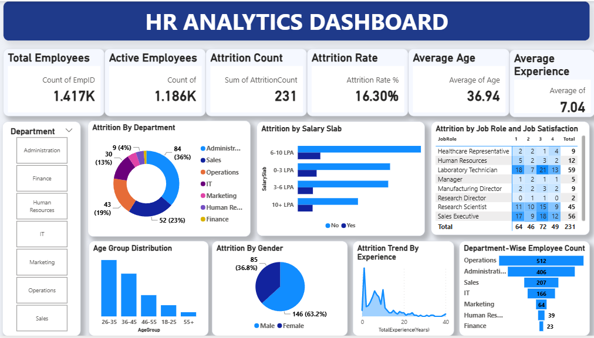

# HR Analytics Dashboard | Power BI

## Project Overview
An interactive HR Analytics dashboard built in Power BI to explore workforce composition and employee attrition. It helps HR teams examine attrition patterns across departments, salary slabs, job roles, age groups, gender, satisfaction, and experience.

## Dashboard KPIs
- **Total Employees:** 1.417K
- **Active Employees:** 1.186K
- **Attrition Count:** 231
- **Attrition Rate:** 16.30%
- **Average Age:** 36.94
- **Average Experience:** 7.04 years

## Dashboard Analysis
- Attrition by Department
- Attrition by Salary Slab
- Attrition by Job Role and Job Satisfaction
- Age Group Distribution
- Attrition by Gender
- Attrition Trend by Experience
- Department-wise Employee Count
- Department filter/slicer for interactive exploration

## Tools & Technologies
- Microsoft Power BI
- Power Query (data transformation)
- DAX (measures and KPIs)
- Data visualization and interactive dashboard design

## Key Questions Explored
- How many employees are currently active and how many have left?
- What is the overall attrition rate?
- How does attrition vary across departments and salary slabs?
- How does attrition vary by job role and satisfaction level?
- What does workforce age and gender distribution look like?
- How does employee experience relate to attrition?

## Dashboard
## Dashboard Preview



## Project Files
- `Dashboard/HR Analytics Dashboard.pbix` — Power BI report.
- `Dataset/HR_Analytics.csv` — dataset used by the report.
- `Images/HR-Analytics-Dashboard.png` — dashboard preview.

## Repository Structure
```
HR-Analytics-Power-BI/
├── Dashboard/
│   └── HR Analytics Dashboard.pbix
├── Dataset/
│   └── HR_Analytics.csv
├── Images/
│   └── HR-Analytics-Dashboard.png
└── README.md
```

## Project Purpose
This project demonstrates HR-focused data analysis, KPI development, data visualization, and interactive reporting with Power BI.

---
**Created as a data analytics portfolio project.**
